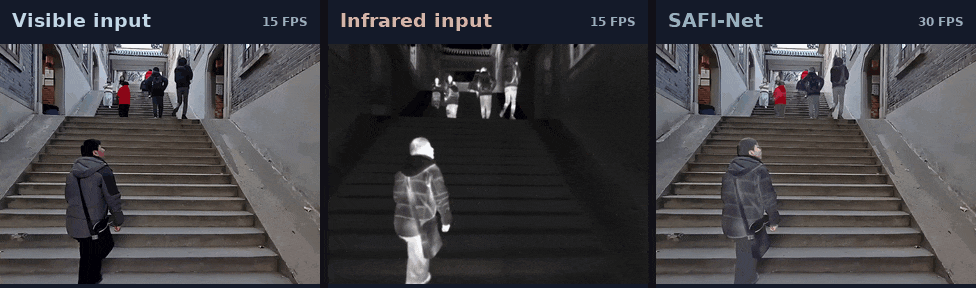
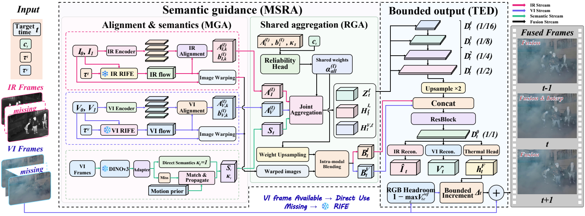

<div align="center">

<h1>🎬 SAFI</h1>

<p><strong>Semantic Guidance for Joint Infrared–Visible Video Fusion and Frame Interpolation</strong></p>

<p><em>Fuse and interpolate in one pass, guided by visible semantics.</em></p>

<p>
  <a href="https://arxiv.org/abs/2611.24277"></a>
  
  
  
</p>

<p>
  <a href="#why-safi">✨ Why SAFI?</a> ·
  <a href="#video-demo">🎞️ Video Demo</a> ·
  <a href="#method">🧩 Method</a> ·
  <a href="#quick-start">⚡ Quick Start</a> ·
  <a href="#inference">▶️ Inference</a> ·
  <a href="#training">🧪 Training</a> ·
  <a href="#citation">📝 Citation</a>
</p>


<p><em>SAFI reconstructs missing observations and fuses infrared and visible frames at a shared target time.</em></p>

</div>

## Why SAFI?

Cascading frame interpolation and image fusion propagates reconstruction errors and introduces brightness fluctuations. SAFI uses visible semantics to guide both tasks within a single unified model.

| Challenge | How SAFI handles it |
| --- | --- |
| Missing observations | Reconstructs missing frames and generates a fused frame at the same target time. |
| Different input rates | Uses the observed visible frame to guide missing infrared reconstruction under asynchronous streams (e.g., 2:1 VIS-to-IR). |
| Brightness fluctuations | Applies bounded thermal enhancement and trains with a temporal brightness consistency loss. |

On HDO, M3SVD, and VTMOT, SAFI achieves higher visual quality and temporal consistency at lower computational cost than cascaded baselines, while supporting downstream multi-object tracking under missing observations.

## Video Demo



## Method



1. **🎯 Target-time semantic guidance.** Extracts [DINOv3](https://huggingface.co/facebook/dinov3-vits16-pretrain-lvd1689m) features directly from an observed visible frame, or propagates semantics from neighboring frames via motion-guided local matching when absent.
2. **🔀 Shared source selection.** Separate [RIFE_m](https://github.com/hzwer/ECCV2022-RIFE) branches align infrared and visible features, with matching confidence weighting aligned sources for both reconstruction and fusion across scales.
3. **💡 Temporal brightness consistency.** Adds bounded thermal enhancement to a visible reference to preserve color while penalizing temporal brightness inconsistencies during training.

## Quick Start

### Install

Requires Python 3.10+, PyTorch, and FFmpeg (for video inference).

```sh
python -m pip install -e .
```

### Download Checkpoint

Download [`weights/safi_net.pt`](weights/safi_net.pt) directly or pull it via [Git LFS](https://git-lfs.com/):

```sh
git lfs install --local
git lfs pull --include="weights/safi_net.pt"
```

### Run Demo

```sh
python -m safi_net.infer_video \
  --ir-input demo/ir --vis-input demo/vis --fps-ir 10 --fps-vis 10 \
  --checkpoint weights/safi_net.pt --output-dir outputs/demo --device cuda:0
```

Fused frames (`fused/`) and the rendered video (`fused.mp4`) are saved to `outputs/demo/`.

## Inference

Inputs should be spatially registered with matching dimensions. For video files, frame rates are read automatically; for frame directories, specify them via `--fps-ir` and `--fps-vis`.

| Mode | Usage |
| --- | --- |
| **Same-rate video** | Set equal input rates (e.g., `--fps-ir 10 --fps-vis 10`) to output observed frames and midpoints. |
| **Different-rate video** | Set a 2:1 VIS-to-IR rate (e.g., `--fps-ir 5 --fps-vis 10`) to follow the visible timeline. |
| **Fast video** | Add `--fast` to reuse features across repeated observations (add `--save-aux` to also save interpolated IR/VIS frames). |
| **Single image fusion** | Run `python -m safi_net.fuse_image` on an aligned IR–VIS image pair. |

<details>
<summary><strong>📋 Example commands (fast mode, different-rate video, and single image fusion)</strong></summary>

### Fast video

```sh
python -m safi_net.infer_video --fast --save-aux \
  --ir-input demo/ir --vis-input demo/vis --fps-ir 10 --fps-vis 10 \
  --checkpoint weights/safi_net.pt --output-dir outputs/demo_fast --device cuda:0
```

### Different-rate video

```sh
python -m safi_net.infer_video \
  --ir-input /path/to/ir_5fps --vis-input /path/to/vis_10fps \
  --fps-ir 5 --fps-vis 10 \
  --checkpoint weights/safi_net.pt --output-dir outputs/demo_async --device cuda:0
```

### Single image fusion

```sh
python -m safi_net.fuse_image \
  --ir-input demo/ir/0000.png --vis-input demo/vis/0000.png \
  --checkpoint weights/safi_net.pt --output outputs/fused.png --device cuda:0
```

</details>

## Training

Prepare the VideoFusion-VFI dataset with `annotations/sequences.jsonl` and paired frames under `train/<sequence>/` and `test/<sequence>/` (uses [`artifacts/split_async.json`](artifacts/split_async.json) by default).

1. **Start joint training:**

   ```sh
   python -m safi_net.pipeline \
     --data-root /path/to/VideoFusion-VFI --run-dir runs/safi \
     --init-from-pretrained --device cuda:0 --batch-size 1 --accumulation-steps 1
   ```

2. **Resume training:**

   ```sh
   python -m safi_net.pipeline \
     --data-root /path/to/VideoFusion-VFI --resume-run runs/safi --device cuda:0
   ```

3. **Export a standalone checkpoint:**

   ```sh
   python -m safi_net.export_weights \
     --checkpoint runs/safi/joint/best.pt --output weights/safi_net_custom.pt
   ```

## Citation

If you find SAFI useful in your research, please consider citing our paper:

```bibtex
@article{xu2026semantic,
  title={Semantic Guidance for Joint Infrared-Visible Video Fusion and Frame Interpolation},
  author={Xu, Yushen and Li, Xiaosong and Wu, Huaming and Ren, Dongwei},
  journal={arXiv preprint arXiv:2611.24277},
  year={2026}
}
```

## Acknowledgements

- **Backbones:** SAFI builds upon [DINOv3 ViT-S/16](https://huggingface.co/facebook/dinov3-vits16-pretrain-lvd1689m) ([license](weights/DINOv3-LICENSE.md)) and [RIFE_m](https://github.com/hzwer/ECCV2022-RIFE) ([license](weights/RIFE-LICENSE)).
- **Third-party notices:** Notices for vendored RIFE and [PMT](https://github.com/tue-mps/pmt) components are provided in [`safi_net/third_party/`](safi_net/third_party/).
