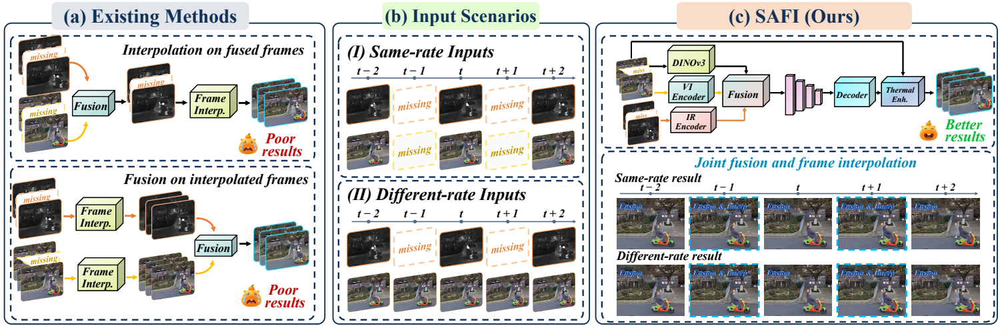

# SAFI-Net

## 🎬 Semantic Guidance for Joint Infrared-Visible Video Fusion and Frame Interpolation

[](https://arxiv.org/abs/2611.24277)



*Graphical abstract. With same-rate inputs, both modalities can lack an observation at the target time. With a faster visible stream, the observed visible frame guides infrared reconstruction.*

SAFI-Net jointly fuses spatially registered infrared and visible video and reconstructs missing observations at the target time. Cascading interpolation and fusion can compound reconstruction errors and introduce brightness fluctuations. SAFI uses visible semantics to guide both tasks on a common timeline.

[🧩 Method](#method) · [⚙️ Install](#install) · [▶️ Inference](#inference) · [🧪 Training](#training) · [📦 Weights](#weight-distribution-and-credits)

## Method


- **Target-time semantic guidance.** SAFI takes DINOv3 features directly from an observed visible frame. When that frame is missing, motion-guided local matching propagates semantics from neighboring visible frames.
- **Shared source selection.** Separate RIFE_m branches align infrared and visible features. Matching confidence helps weight the aligned sources, and reconstruction and fusion share those weights at each scale.
- **Temporal brightness consistency.** The decoder adds bounded thermal enhancement to a visible reference to preserve its color. Training penalizes brightness inconsistencies across frames while accounting for changes in thermal contrast.

Experiments on HDO, M3SVD, and VTMOT show improved visual quality with lower computational cost than the evaluated cascades, as well as improved temporal consistency for different-rate inputs. On VTMOT, SAFI also supports downstream multi-object tracking under missing observations.

## Install

Use Python 3.10 or newer and a PyTorch build for your device. Install FFmpeg with `libx264` and `ffprobe` for video inference.

```sh
python -m pip install -e .
```

## Inference

Place the self-contained `safi_net.pt` release asset in `weights/`. It includes the task network, DINOv3, and both trained RIFE_m branches. Use it with all three commands below. An existing SAFI-Net training `best.pt` also works with the original backbone files under `pretrained/`.

> **🎞️ Try the demo.** The demo contains nine synthetic, spatially aligned pairs at 256 × 192 pixels.

Use the same commands with your own registered images or videos.

- **Video files.** The CLI reads frame rates and timestamps from the files by default. Supply `--fps-ir` and `--fps-vis` if the nominal rates need to be specified explicitly.
- **Frame directories.** Set `--fps-ir` and `--fps-vis` to the input sampling rates, or provide JSON timestamps with `--timestamps-ir` and `--timestamps-vis`.

Use `--fps-ir 10 --fps-vis 10` for the bundled same-rate demo. The other supported setting has visible frames at twice the infrared rate, for example `--fps-ir 5 --fps-vis 10`. To try it with the demo, copy `0000.png`, `0002.png`, `0004.png`, `0006.png`, and `0008.png` from `demo/ir/` into a separate directory and use that as the IR input. Use all nine frames from `demo/vis/` as the VIS input.

### Video

```sh
python -m safi_net.infer_video \
  --ir-input demo/ir --vis-input demo/vis --fps-ir 10 --fps-vis 10 \
  --checkpoint weights/safi_net.pt --output-dir outputs/demo --device cuda:0
```

This example produces 17 fused PNGs under `outputs/demo/fused/` and an MP4. The output times and checkpoint identity are saved in `summary.json`.

### Fast video inference

```sh
python -m safi_net.infer_video --fast --save-aux \
  --ir-input demo/ir --vis-input demo/vis --fps-ir 10 --fps-vis 10 \
  --checkpoint weights/safi_net.pt --output-dir outputs/demo_fast --device cuda:0
```

The fast runtime uses FP32 and reuses features for repeated observations. `--save-aux` adds IR and VIS interpolation frames. Use `--precision float32` on the standard path to compare it with the fast path. To run video inference on CPU, use `--device cpu --precision float32`.

### Image fusion

```sh
python -m safi_net.fuse_image \
  --ir-input demo/ir/0000.png --vis-input demo/vis/0000.png \
  --checkpoint weights/safi_net.pt --output outputs/fused.png --device cuda:0
```

Provide two images with the same spatial dimensions. The output is a single RGB PNG at the input size. Image fusion also accepts `--device cpu`.

## Training

Use a VideoFusion-VFI dataset root with `annotations/sequences.jsonl` and infrared and visible frames under `train/<sequence>/` and `test/<sequence>/`. The default split is `artifacts/split_async.json`. For a different copy of the dataset, generate a split with `python -m safi_net.split_manifest --help` and pass it with `--manifest`.

The initial DINOv3 and RIFE_m files are under `pretrained/`. Run `(cd pretrained && sha256sum -c SHA256SUMS)` to verify them. This starts a new joint run using those backbone weights.

```sh
python -m safi_net.pipeline \
  --data-root /path/to/VideoFusion-VFI --run-dir runs/safi \
  --init-from-pretrained --device cuda:0 --batch-size 1 --accumulation-steps 1
```

Adjust the batch size and accumulation for your hardware. Training saves `runs/safi/joint/latest.pt` and selects `best.pt` using sampled validation. Use the training snapshot to resume with optimizer and RNG state.

```sh
python -m safi_net.pipeline \
  --data-root /path/to/VideoFusion-VFI --resume-run runs/safi --device cuda:0
```

Export a new single-file inference checkpoint after training.

```sh
python -m safi_net.export_weights \
  --checkpoint runs/safi/joint/best.pt --output weights/safi_net.pt
```

For the test suite, install `python -m pip install -e '.[dev]'` and run `python -m pytest`.

## Weight distribution and credits

Attach `safi_net.pt`, `safi_net.pt.sha256`, and the [DINOv3](pretrained/dinov3/LICENSE.md) and [RIFE](pretrained/rife/LICENSE) licenses to the GitHub Release. The repository ignores local copies under `weights/`. After downloading, run `(cd weights && sha256sum -c safi_net.pt.sha256)`. See [GitHub release assets](https://docs.github.com/en/repositories/releasing-projects-on-github/about-releases).

SAFI-Net uses [DINOv3 ViT-S/16](https://huggingface.co/facebook/dinov3-vits16-pretrain-lvd1689m) and [RIFE_m](https://github.com/hzwer/ECCV2022-RIFE). The vendored RIFE and [PMT](https://github.com/tue-mps/pmt) source notices are in [`safi_net/third_party/`](safi_net/third_party/).
